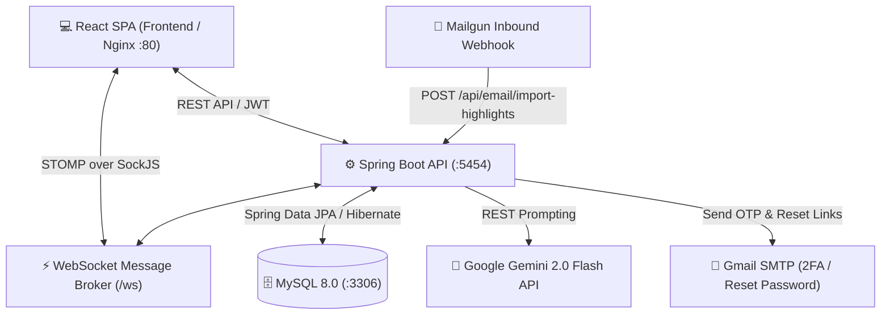

# 📖 QuoteHub – AI-Powered Social Network for Kindle Book Quotes


> **QuoteHub** is a specialized micro-blogging and social networking platform designed for book lovers to share, curate, and discuss highlights synced directly from **Amazon Kindle**. It features automated email inbound parsing, multi-tier AI content moderation, real-time interactive notifications, and an intuitive admin analytics portal.

---

## 🌟 Key Features

### 📚 1. Micro-Blogging & Book Quotes
- **Quote-Centric Feeds:** Create posts attached to verified book quotes and highlights.
- **Smart Newsfeed Algorithm:** Hybrid feed delivering prioritized content from followed users (4:1 ratio) mixed with trending community posts.
- **Social Interactions:** Like, retweet, bookmark, and multi-level threaded replies.
- **Book & Friend Trends:** Real-time discovery of top trending books in the community and amongst friends.

### 📥 2. Automated Kindle Highlights Synchronization
- **Mailgun Inbound Webhook:** Each user receives a dedicated address (`kindle+<token>@domain`). Exporting notes directly from the Kindle app triggers an automated background webhook.
- **HTML Parsing Engine:** Uses **Jsoup** to parse Kindle HTML export files, extracting positions, titles, authors, and highlight texts while preventing duplicates.
- **Manual Upload Fallback:** Upload exported `.html` files directly through the web UI.

### 🤖 3. AI-Powered Intelligence (Google Gemini 2.0 Flash)
- **Automated Multi-Tier Moderation:** AI analyzes posts and comments for hate speech, harassment, violence, and explicit content:
  - `Risk Score < 0.3` ➔ **APPROVED** (Instantly published)
  - `0.3 <= Risk Score < 0.7` ➔ **PENDING** (Sent to Admin moderation queue)
  - `Risk Score >= 0.7` ➔ **BLOCKED** (Restricted from public feed)
- **Book Metadata Enrichment:** Automatically generates book summaries, reading difficulty levels, target audiences, and Vietnamese topic hashtags.
- **Multi-Label Categorization:** Categorizes quotes into thematic labels (e.g., *Inspiration, Love, Philosophy*).

### ⚡ 4. Real-Time Engine (WebSockets - STOMP & SockJS)
- **Push Notifications:** Instant alerts for Likes, Comments, Retweets, and Follows.
- **Dynamic Content Moderation:** Live synchronization of moderated/blocked posts across active user feeds without page reloads.
- **Live Admin Dashboard:** Real-time updates of analytics charts and flagged report counts.
- **Kindle Import Progress:** Live status updates when background email imports complete.

### 🛡️ 5. Authentication & Enterprise-Grade Security
- **Stateless Authentication:** JSON Web Token (JWT) architecture with Spring Security 6.
- **Two-Factor Authentication (2FA):** 6-digit email OTP verification with a 5-minute expiration window via Gmail SMTP.
- **Secure Password Recovery:** One-time UUID reset tokens with strict expiry validation.
- **Role-Based Access Control (RBAC):** Strict permissions dividing regular `USER` and `ADMIN` privileges with built-in self-demotion prevention.

---

## 🏗️ System Architecture



---

## 🛠️ Tech Stack

| Category | Technologies |
| :--- | :--- |
| **Backend** | Java 17, Spring Boot 3.5.5, Spring Security 6, Spring Data JPA, Hibernate, Spring WebSocket |
| **Frontend** | React 19, Redux, Redux Thunk, React Router v7, Material UI (MUI v7), Tailwind CSS, Formik, Yup, Axios |
| **Database** | MySQL 8.0 |
| **Realtime** | STOMP Protocol, SockJS |
| **AI / NLP** | Google Gemini 2.0 Flash REST API |
| **Third-Party** | Mailgun (Inbound Email Routing), Jsoup (HTML Parser), Gmail SMTP |
| **DevOps** | Docker, Docker Compose, Multi-stage Build, Nginx Alpine |

---

## 🚀 Quick Start with Docker Compose

Ensure you have [Docker](https://www.docker.com/) and [Docker Compose](https://docs.docker.com/compose/) installed.

### 1. Clone the repository
```bash
git clone https://github.com/VietNamBui/QuoteHub.git
cd QuoteHub
```

### 2. Configure Environment Variables
You can customize database passwords or port bindings directly inside `docker-compose.yml`.

### 3. Build & Run
```bash
docker-compose up --build -d
```

### 4. Access the Application
- **Frontend Web UI:** `http://localhost:80`
- **Backend API:** `http://localhost:5454`
- **MySQL Database:** `localhost:3306`

---

## 💻 Local Development Setup

### Prerequisites
- **JDK 17** or higher
- **Node.js 18+** & npm
- **MySQL 8.0+**
- **Maven 3.9+**

### 1. Database Setup
Create a MySQL database named `twitter_youtube`:
```sql
CREATE DATABASE twitter_youtube CHARACTER SET utf8mb4 COLLATE utf8mb4_unicode_ci;
```

### 2. Backend Setup
Navigate to the backend directory and configure `src/main/resources/application.properties`:
```properties
server.port=5454
spring.datasource.url=jdbc:mysql://localhost:3306/twitter_youtube
spring.datasource.username=root
spring.datasource.password=your_mysql_password

# Gemini AI API Configuration
ai.api.url=https://generativelanguage.googleapis.com/v1beta/models/gemini-2.0-flash:generateContent
ai.api.key=YOUR_GEMINI_API_KEY

# SMTP Gmail Configuration (For 2FA & Password Reset)
spring.mail.username=your_email@gmail.com
spring.mail.password=your_app_password
```

Build and run the Spring Boot server:
```bash
cd back_end/social_media
./mvnw clean spring-boot:run
```

### 3. Frontend Setup
Navigate to the frontend directory, install dependencies, and start the development server:
```bash
cd front_end
npm install
npm start
```
The React development server will start at `http://localhost:3000`.

---

## 📡 Key API Endpoints Overview

| Method | Endpoint | Description | Access |
| :--- | :--- | :--- | :--- |
| `POST` | `/auth/signup` | Register new user account | Public |
| `POST` | `/auth/signin` | Request login & trigger 2FA OTP | Public |
| `POST` | `/auth/verify-otp` | Verify 2FA OTP & obtain JWT | Public |
| `POST` | `/auth/forgot-password` | Send password reset link | Public |
| `POST` | `/api/email/import-highlights` | Mailgun inbound webhook for Kindle notes | Webhook |
| `GET` | `/api/email/import-address` | Get user's unique Kindle forwarding address | Authenticated |
| `POST` | `/api/twits/create` | Post a twit with quote (AI moderation applied) | Authenticated |
| `GET` | `/api/twits/feed` | Get prioritized hybrid newsfeed | Authenticated |
| `GET` | `/api/twits/trending/books` | Get top trending books across the platform | Authenticated |
| `POST` | `/api/books/{id}/ai-enrich` | Trigger Gemini AI metadata generation for a book | Authenticated |
| `GET` | `/api/admin/analytics` | Get platform analytics & moderation counts | Admin |
| `POST` | `/api/moderation/twits/{id}/approve` | Approve a flagged post | Admin |
| `POST` | `/api/moderation/twits/{id}/reject` | Reject/block a flagged post | Admin |

---

## 🔒 Security Best Practices
- Passwords hashed using **BCrypt** with high salt rounds.
- Stateless session management (`SessionCreationPolicy.STATELESS`).
- Strict CORS policies configured for allowed frontend origins.
- Webhook authorization checks sender emails against the registered account email to prevent spoofing.
- Self-demotion safeguards prevent admins from locking themselves out or leaving the system with zero admins.

---

## 👨‍💻 Author
**VietNamBui**
- GitHub: [@VietNamBui](https://github.com/VietNamBui)
- Repository: [QuoteHub](https://github.com/VietNamBui/QuoteHub)

---

## 📄 License
This project is open-source and available under the [MIT License](LICENSE).